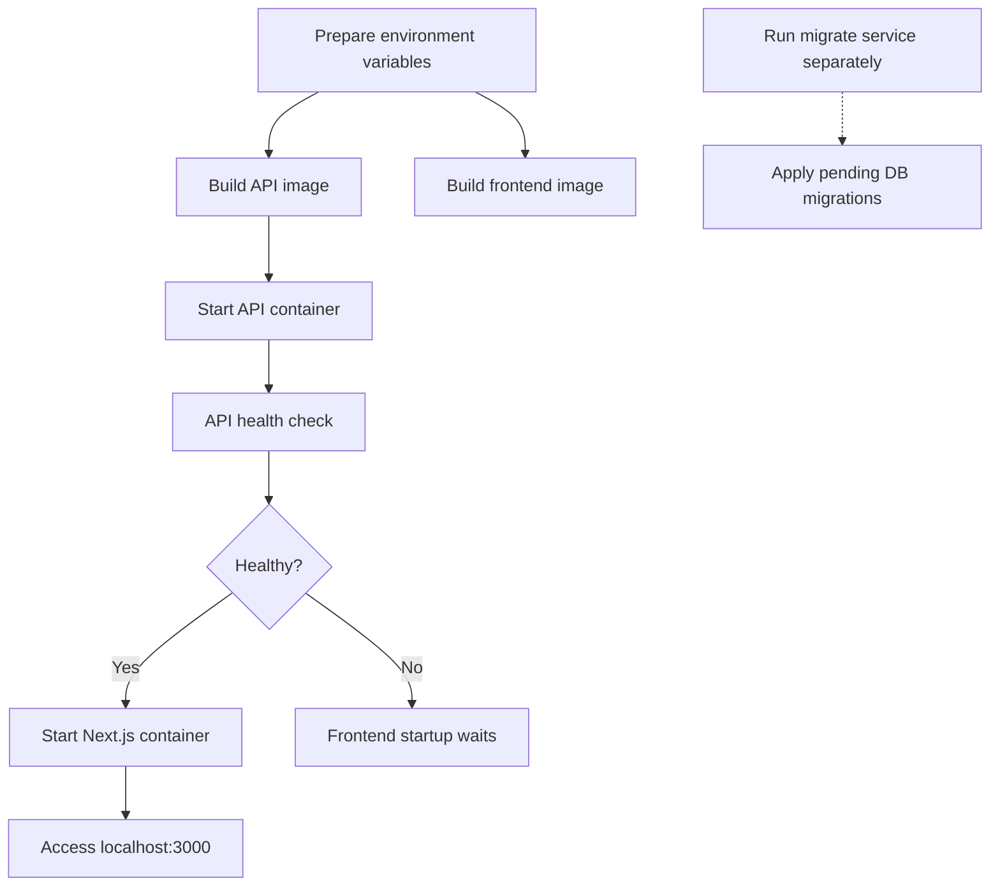

# Smart Content Manager

AI-powered content and campaign management platform.

## Tech Stack

* Next.js
* Express.js
* PostgreSQL
* Prisma
* TypeScript
* Docker (Compose v2)

## Prerequisites

For local development:

- Node.js 22+
- Bun
- PostgreSQL

For Docker Compose:

- Docker Engine with the Compose v2 plugin (`docker compose`)
- A reachable PostgreSQL database (local or hosted) set via `DATABASE_URL` in `apps/api/.env`

## Project Structure

```text
apps/
├── web      # Frontend (Next.js)
└── api      # Backend (Express)
```

## Getting Started

### Install dependencies

```bash
bun install
```

## Configure environment variables

Create:

- `apps/web/.env`
- `apps/api/.env`

See `.env.example` files for required variables.

### Run Prisma migrations

```bash
cd apps/api
bunx --bun prisma migrate dev
```

### Start development servers

```bash
bun run dev
```

Starts both:

- Frontend: http://localhost:3000
- Backend: http://localhost:8000

## Run with Docker Compose

Copy the env examples and fill them in (`DATABASE_URL`, secrets, etc.):

```bash
cp apps/api/.env.example apps/api/.env
cp apps/web/.env.example apps/web/.env
```

Also export a `NEXT_SERVER_ACTIONS_ENCRYPTION_KEY` in the shell (or set it in a root `.env`):

```bash
export NEXT_SERVER_ACTIONS_ENCRYPTION_KEY=$(openssl rand -base64 32)
```

Build and start:

```bash
docker compose build
docker compose up
```

Apply pending DB migrations (one-off service):

```bash
docker compose run --rm migrate
```

Frontend: http://localhost:3000 · Backend: http://localhost:3001



## Build

```bash
bun run build
```

## Monorepo Tooling

- **Turborepo** (build system) orchestrates and optimizes tasks across applications.
- **Bun** powers the backend runtime and Prisma commands and package manager for frontend.